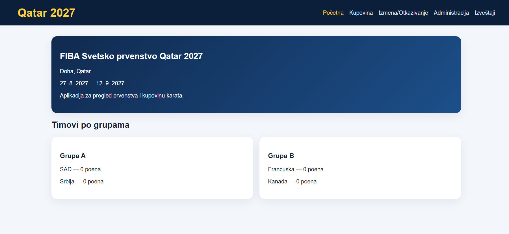
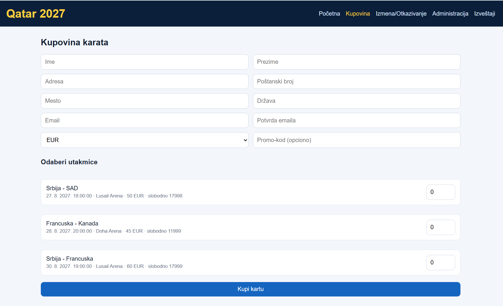
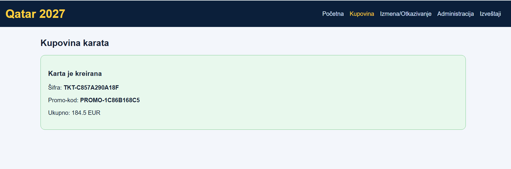
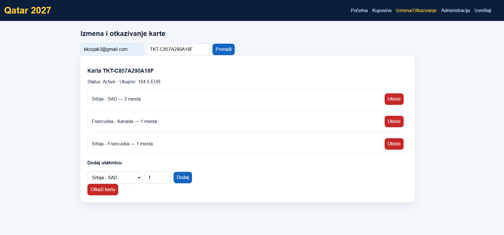
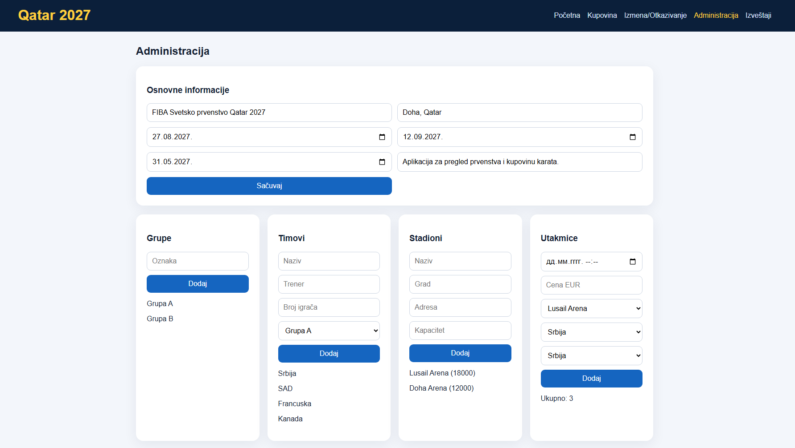
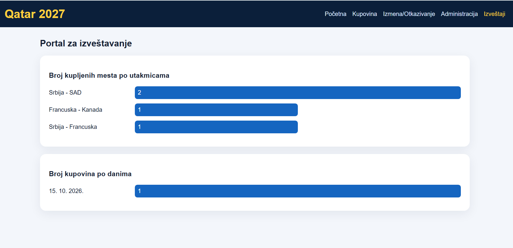

# Basketball World Cup Management System – Qatar 2027

A full-stack web application developed for organizing and managing the **Qatar 2027 Basketball World Cup**.

The project follows **Architecture A** and consists of two interconnected modules:

- **A.1 – Championship Administration:** Management of tournament information, teams, groups, stadiums, matches, ticket prices, and currencies.
- **A.2 – Customer Portal:** A web interface for viewing tournament information, purchasing tickets, and managing reservations.

Both modules share a centralized MySQL database and communicate through an ASP.NET Core Web API.

## 1. Technologies Used


| Frontend - React 18, TypeScript |
| Backend - ASP.NET Core 8 Web API, C# |
| Database - MySQL |
| Object-Relational Mapping - Entity Framework Core |
| Caching - ASP.NET Core Memory Cache |
| API Documentation - Swagger |
| Development Environment - Visual Studio Community |
| Package Management - npm, NuGet |

## 2. Key Features

### Customer Portal

- Display of general championship information
- Overview of tournament groups, national teams, and matches
- In-memory caching for improved data retrieval performance
- Ticket purchasing for one or multiple matches
- Automatic 10% discount for purchases made before a specified date
- Additional 5% discount when a valid promotional code is applied
- Automatic generation of unique ticket access codes
- Generation of promotional codes after successful purchases
- Support for multiple currencies
- EUR currency conversion using an external exchange-rate API
- Fallback exchange rates when the external API is unavailable
- Searching and retrieving purchased tickets
- Modification of existing ticket reservations
- Ticket cancellation with historical record preservation

### Administration

- Championship information management
- Creation, modification, and deletion of tournament groups
- National team management
- Stadium management
- Match scheduling and modification
- Ticket price configuration
- Currency management
- Ticket sales overview
- Sales reports grouped by matches and dates
- Graphical visualization of statistical data

## Application Screenshots

The following screenshots demonstrate the main
features and user interface of the application.

### Home Page


### Ticket Booking



### Reservation Management


### Administration Panel


### Sales Reports


## 3. Project Requirements

This application was developed as an academic project focused on designing and implementing a full-stack information system.

The project requirements define the functional specifications, system architecture, administrative operations, ticket purchasing workflow, database integration, and reporting capabilities.

The original project assignment is available in Serbian:

**[View Project Requirements (PDF)](docs/Project_Requirements.pdf)**

The document describes the original assignment, while this README provides an overview of the implemented system and instructions for running the application.

## 4. Prerequisites

Before running the application, install the following software:

1. Visual Studio Community 2022 or newer, with ASP.NET Core development support
2. .NET 8 SDK
3. Node.js LTS with npm
4. MySQL Server
5. SQLyog or MySQL Workbench

Verify the installations using:

```powershell
node -v
npm -v
dotnet --version
```

## 5. Database Setup

The application uses a centralized MySQL database shared by both system modules.

### Installation Steps

1. Start the MySQL Server.
2. Open SQLyog or MySQL Workbench.
3. Locate the `sql/database.sql` file.
4. Execute the SQL script.
5. Verify that the database and required tables have been created.

### Default Database Configuration

**Database name:**

`SvetskoPrvenstvoUKosarci`

**Username:**

`root`

**Password:**

Empty by default in the local development configuration.

If your MySQL installation uses different credentials, update the database connection string in:

`backend/API/appsettings.json`

For security, use local configuration or environment variables for database credentials rather than committing passwords to the repository.

**Important:** Before executing the SQL script again, check whether it contains `DROP TABLE` statements, as these may permanently remove existing data.

## 6. Backend Setup

The backend is implemented using ASP.NET Core 8 Web API and Entity Framework Core.

### Option A – Run with Visual Studio Community

1. Open Visual Studio Community.
2. Select `File → Open → Project/Solution`.
3. Open `backend/SvetskoPrvenstvoUKosarci.sln`.
4. Set the `API` project as the Startup Project.
5. Run the application using `F5` or `Ctrl + F5`.

### Option B – Run from the Terminal

From the root directory of the repository:

```powershell
cd backend/API
dotnet restore
dotnet run
```

Once the backend starts successfully, the Swagger API documentation is available at:

**http://localhost:5260/swagger**

This address applies when the backend is configured to use port 5260.

Keep the backend running while using the frontend application.

## 7. Frontend Setup

The frontend is developed using React 18 and TypeScript.

### Install Dependencies

Open a terminal in the repository root directory and run:

```powershell
cd frontend
npm install
```

This command installs the dependencies defined in `package.json`.

### TypeScript Validation

Before starting the application, verify that the TypeScript code compiles correctly:

```powershell
npx tsc --noEmit
```

If the command finishes without reporting errors, the TypeScript validation has passed.

### Start the Frontend

Run:

```powershell
npm start
```

After successful compilation, the frontend should be available at:

**http://localhost:3000**

**Note:** The project uses `react-scripts`, so the correct startup command is `npm start`, not `npm run dev`.

## 8. Running the Complete System

To run the complete application, follow this order:

1. Start MySQL Server.
2. Verify that the `SvetskoPrvenstvoUKosarci` database exists.
3. Start the ASP.NET Core backend.
4. Verify that Swagger documentation is accessible.
5. Open a separate terminal.
6. Navigate to the `frontend` directory.
7. Run `npm start`.
8. Open http://localhost:3000 in your browser.

The backend and frontend must remain running during application usage.

## 9. Application Testing

After starting the complete system, the following functionalities can be tested:

- Loading the home page
- Displaying groups and national teams
- Viewing scheduled matches
- Purchasing tickets for one or multiple matches
- Applying promotional discounts
- Generating ticket access codes
- Converting ticket prices into different currencies
- Searching and modifying existing reservations
- Cancelling reservations
- Managing tournament information through the administrative interface
- Generating sales reports
- Displaying statistical charts

## 10. Additional Technical Notes

The backend uses Entity Framework Core for database access and data management.

When `Database.EnsureCreated()` is enabled in the Development environment, Entity Framework Core creates the database schema if it does not exist.

However, `EnsureCreated()` does not apply migrations or update an existing database schema.

For initial database configuration, using the provided `sql/database.sql` script is recommended.

The frontend must also be configured to communicate with the correct backend API address.

## 11. Project Purpose

This project was developed to demonstrate practical knowledge of full-stack web development, RESTful API integration, relational databases, and client-server architecture.

It combines React, TypeScript, ASP.NET Core, and MySQL to implement a complete information system for basketball championship management, including ticket booking, administrative operations, and sales reporting.
